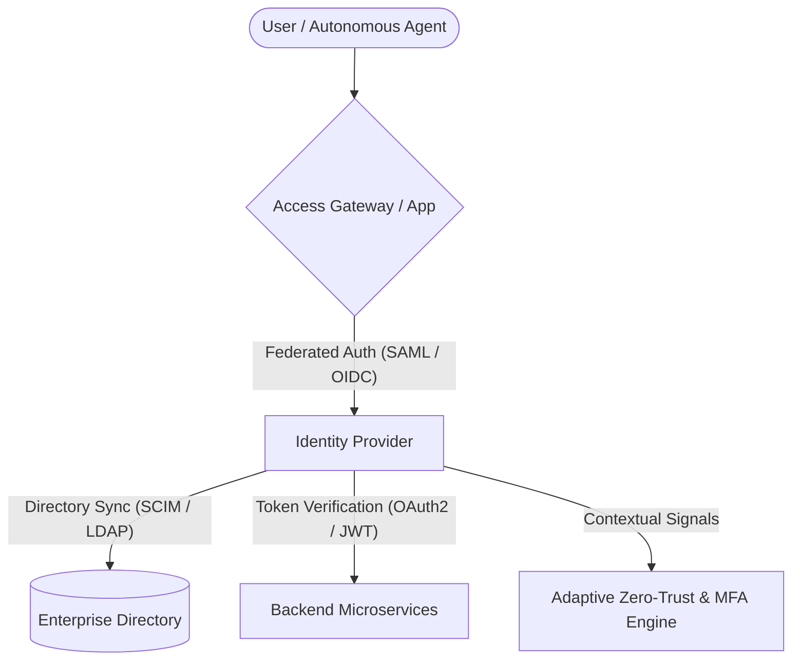

# 🔐 Awesome Single Sign-On & Identity Management (IAM)

**A curated, production-oriented directory of enterprise Single Sign-On (SSO), Identity & Access Management (IAM), Customer Identity (CIAM), and self-hosted identity providers (IdPs).**

*Covering SAML 2.0, OpenID Connect (OIDC), OAuth 2.0, SCIM 2.0, FIDO2/WebAuthn Passkeys, Zero Trust security, and autonomous AI Agent IAM governance.*

[Sector Overview](#-sector-overview--market-dynamics) • [SaaS Platforms](#-saas--hosted-identity-platforms) • [Open-Source Solutions](#-open-source-identity-projects) • [Architecture Guide](#-frameworks-and-architecture-selection) • [Star History](#-star-history) • [Support](#-support) • [Contributing](#-how-to-contribute)

---

## 🌐 Sector Overview & Market Dynamics

The global Identity and Access Management (IAM) market is estimated at **$18.5 billion to $20.8 billion in 2026** (projected to exceed $41 billion by 2031 at an ~13.5% CAGR), driven by Zero Trust mandates, decentralized cloud sprawl, SaaS app federation, and emerging non-human / autonomous AI agent identity lifecycles. 

The sector is **moderately concentrated at the mega-enterprise tier**—dominated by colossal cloud ecosystems (Microsoft Entra ID) and pure-play cybersecurity giants (Okta, CyberArk, Ping Identity)—yet remains **vibrantly fragmented and competitive** across specialized developer CIAM, modern open-source identity infrastructure (Keycloak, Authentik, Zitadel), and niche cloud directory alternatives.

---

## ☁️ SaaS & Hosted Identity Platforms

| Platform | Company Valuation / Revenue | Starting Price | Free Tier / Trial Limit | Key Features & SSO Capabilities |
| :--- | :--- | :--- | :--- | :--- |
| **[Microsoft Entra ID](https://www.microsoft.com/en-us/security/business/microsoft-entra)** | **$3.1T+ Market Cap** (~$245B+ Annual Revenue) | **$3.00 / user / month** (Entra ID P1; P2 at $9.00 / user / month) | **Free tier included with Azure / M365** (core directory, up to 500k objects, unlimited SSO to 10 apps per user on basic tier, self-service password reset) | Deep M365/Azure native federation, Conditional Access, Phish-Resistant MFA, FIDO2, Linux desktop broker, SCIM provisioning. |
| **[Crowd (Atlassian)](https://www.atlassian.com/software/crowd)** | **~$45B Market Cap** (~$4.4B Annual Revenue) | **$1,400 one-time** (Data Center tier for 500 users) | **30-day full-featured free trial** (unlimited users and directories during trial) | On-premises centralized identity & SSO for Jira, Confluence, and Bitbucket. Supports Active Directory, LDAP, Azure AD, SAML, and OIDC. |
| **[CyberArk](https://www.cyberark.com/)** | **~$15B Market Cap** (~$1.0B Annual Revenue) | **$2.00 / user / month** (Workforce Identity SSO/MFA tier) | **30-day full-featured free trial** (identity security suite with adaptive MFA & SSO) | Privileged access management (PAM), Identity Governance & Administration (IGA), AI session protection, Google Workspace & Microsoft SSO. |
| **[Okta](https://www.okta.com/)** | **~$14B Market Cap** (~$2.6B Annual Revenue) | **$2.00 / user / month** (Single Sign-On tier; Adaptive SSO at $5.00 / user / month) | **30-day free trial** (unlimited apps and test users); Free Developer Tier up to 7,500 monthly active users (MAU) | Universal Directory, Cross App Access, Agent SSO for autonomous AI agents, 7,000+ pre-integrated app catalog, SCIM lifecycle automation. |
| **[Ping Identity](https://www.pingidentity.com/)** | **~$6.5B Valuation** (Acquired by Thoma Bravo; merged with ForgeRock) | **$3.00 / user / month** (PingOne Workforce Essentials tier) | **30-day free trial** (includes full access to PingOne Cloud Platform, PingFederate, and PingID MFA) | Enterprise workforce & customer IAM, Agent IAM Core, PingFederate 13.1, JWT client assertions, complex hybrid legacy federation. |
| **[OneLogin](https://www.onelogin.com/)** | **~$4.5B Parent Valuation** (Acquired by One Identity / Quest Software) | **$2.00 / user / month** (SSO Starter; Advanced at $4.00 / user / month) | **30-day free trial** (full access to SSO catalog, smart factor MFA, and directory connectors) | Risk-based SmartFactor MFA, automated real-time provisioning/deprovisioning, desktop SSO, Active Directory / LDAP multi-connector sync. |
| **[JumpCloud](https://jumpcloud.com/)** | **~$3.0B Valuation** (backed by Sapphire & General Atlantic) | **$9.00 / user / month** (Identity Package; standalone SSO at $3.00 / user / month) | **Free plan for up to 10 users & 10 devices** (with 10 days of premium chat support, full SSO, MDM, Cloud LDAP/RADIUS) | Open directory platform combining unified cross-OS device management (macOS, Windows, Linux, iOS, Android), passwordless JumpCloud Go, and Cloud RADIUS/LDAP. |
| **[Auth0](https://auth0.com/)** | **$6.5B Acquisition Value** (Okta subsidiary) | **$35.00 / month** (B2C Essentials; B2B starting at $130.00 / month) | **Free forever plan up to 7,500 active users** (includes unlimited social logins, passwordless, self-service SSO, SCIM, and 1 enterprise connection) | Developer-centric CIAM & B2B SaaS authentication, universal login pages, multi-tenant organization isolation, extensive SDK coverage. |
| **[ForgeRock](https://www.forgerock.com/)** | **$2.3B Acquisition Value** (Acquired by Thoma Bravo / Ping Identity) | **$5.00 / user / month** (Identity Cloud starting enterprise tier) | **30-day free enterprise cloud trial** (evaluates Identity Platform, Access Management & Identity Gateway) | High-scale customer and workforce identity orchestration, identity trees, fine-grained dynamic authorization, and hybrid edge gateways. |
| **[Keycloak Cloud (Phase Two)](https://phasetwo.io/)** | **Seed Funded** (~$10M Valuation / SaaS Managed Keycloak) | **$99.00 / month** (Phase Two Managed Starter cluster) | **Free forever Developer Tier up to 1,000 monthly active users** (shared cluster with full Keycloak SSO & admin API) | Dedicated managed hosting for Keycloak, automated version upgrades, high availability, multi-tenant organizations, and enterprise IdP brokering. |

---

## 💻 Open-Source Identity Projects

All open-source repositories are ranked by GitHub community stargazers (descending) with direct links to repo stargazers and official source code.

| Project | GitHub Stars | License | Primary Tech Stack | Description & Protocols |
| :--- | :--- | :--- | :--- | :--- |
| **[Keycloak](https://github.com/keycloak/keycloak)** |  | Apache-2.0 | Java / Quarkus | The industry-standard open-source IAM and SSO platform. Supports SAML 2.0, OpenID Connect, OAuth 2.0, Kerberos, SCIM 2.0, identity brokering, dynamic user federation, and multi-tenant realm isolation. |
| **[Authelia](https://github.com/authelia/authelia)** |  | Apache-2.0 | Go / TypeScript | Lightweight authentication and authorization server acting as an identity portal for reverse proxies (Nginx, Traefik, Caddy, Envoy). Provides 2FA, FIDO2/WebAuthn, TOTP, Duo push, and OIDC provider capabilities. |
| **[Authentik](https://github.com/goauthentik/authentik)** |  | GPL-3.0 / Enterprise | Python / Go / Vue | Highly customizable, security-hardened identity provider featuring dynamic flow-based authentication, SAML 2.0, OIDC, SCIM outbound, LDAP outpost proxying, and a polished visual management dashboard. |
| **[Ory Hydra](https://github.com/ory/hydra)** |  | Apache-2.0 | Go | Hardened, OpenID Foundation certified OAuth 2.0 and OpenID Connect engine. Headless and API-first; bridges authentication flows without taking over user databases or UI workflows. |
| **[Zitadel](https://github.com/zitadel/zitadel)** |  | Apache-2.0 | Go / Next.js | Modern cloud-native "Identity Infrastructure for Developers" with turn-key multi-tenancy, event sourcing, B2B org structures, passkeys/FIDO2, SAML, and OIDC federation. |
| **[SuperTokens](https://github.com/supertokens/supertokens-core)** |  | Apache-2.0 | Java / Node / React | Modular open-source Auth0 alternative providing end-to-end authentication, session management, enterprise SSO (SAML/OAuth2 integration), social login, passwordless, and pre-built frontend UI widgets. |
| **[Logto](https://github.com/logto-io/logto)** |  | MPL-2.0 | TypeScript / Node.js | Modern, developer-friendly open-source IAM and Auth0 alternative designed for B2B and SaaS applications. Supports Enterprise SSO (SAML/OIDC), RBAC, multi-tenant organizations, and WebAuthn. |
| **[Casdoor](https://github.com/casdoor/casdoor)** |  | Apache-2.0 | Go / React | UI-first identity and access management system with centralized administration. Built-in integration with Casbin for RBAC/ABAC authorization, SAML, OIDC, OAuth, WebAuthn, LDAP sync, and SCIM 2.0. |
| **[Ory Kratos](https://github.com/ory/kratos)** |  | Apache-2.0 | Go | Headless, API-first identity and user management system built to cloud-native standards. Implements login, registration, multi-factor authentication, account recovery, profile verification, and social sign-in. |
| **[Apereo CAS](https://github.com/apereo/cas)** |  | Apache-2.0 | Java / Spring Boot | Battle-tested, enterprise-grade Single Sign-On engine historically dominant in higher education and large research institutions. Supports CAS protocol, SAML2, OIDC, OAuth, and distributed caching clusters. |
| **[WSO2 Identity Server](https://github.com/wso2/product-is)** |  | Apache-2.0 | Java | Comprehensive enterprise identity federation server managing billions of identities. Supports adaptive risk-based authentication, SAML 2.0, OIDC, SCIM 2.0, XACML, and WS-Federation. |
| **[VoidAuth](https://github.com/voidauth/voidauth)** |  | AGPL-3.0 | Go / Svelte | Open-source SSO provider crafted specifically for self-hosted homelabs and reverse proxy infrastructures (Caddy, Traefik, Nginx). Implements ForwardAuth target, OIDC, LDAP, passkeys, and encrypted storage. |
| **[Burrow](https://github.com/ArkGravity/burrow)** |  | MIT | Go / React | Ultralightweight, zero-bloat OIDC and SAML identity provider for small engineering teams. Deploys as a single static binary with embedded web UI, mandatory PKCE S256, and auditable role-based permissions. |

---

## 🛠️ Frameworks and Architecture Selection

When architecting an identity and access federation layer, consider these architectural archetypes:

- **Full Enterprise Suite (Open-Source)**: Choose **Keycloak** or **WSO2 IS** if you need comprehensive multi-protocol federation, legacy AD/LDAP synchronization, and out-of-the-box SCIM 2.0 server capabilities without vendor lock-in.
- **Modern Infrastructure & Flow Design**: Choose **Authentik** for an intuitive visual policy workflow engine, or **Zitadel** / **Logto** for turnkey developer CIAM and B2B SaaS tenancy.
- **Lightweight & Reverse-Proxy Deployments**: Choose **Authelia**, **VoidAuth**, or **Burrow** to place fast, low-footprint authentication in front of self-hosted microservices and homelab apps without running heavyweight JVM clusters.
- **Headless & Microservices-Native**: Choose **Ory (Hydra + Kratos)** or **SuperTokens** to retain total control over your UX and frontend brand while delegating crypto, session tokens, and OAuth2 compliance to hardened backend engines.
- **Managed Enterprise AI Agent Governance**: Choose **Okta Agent SSO** or **PingOne Agent IAM Core** when managing non-human machine tokens, cross-application identity governance, and compliance audit automation.

---

## 🤝 How to Contribute

Contributions are warmly welcomed! Help keep this IAM ecosystem directory accurate and comprehensive:

1. Fork this repository.
2. Ensure new additions include verifiable pricing, company metrics, or GitHub star data.
3. Submit a Pull Request with a concise summary of updates.

⭐ **Star this repository** if it helped you navigate the identity management landscape!

---

## 💖 Support

Thank you for exploring this curated guide to Single Sign-On and Identity Management! If you find this directory valuable for your research, team, or projects:

- ⭐ **Star this repository** to help others discover it.
- 🍴 **Fork it** and contribute your insights, corrections, or tools.
- 📢 **Share it** with your network, fellow engineers, and security teams.
- ☕ **Buy a coffee**: Support ongoing maintenance and curated open-source research on the [GitHub Sponsor Dashboard](https://github.com/sponsors/ishandutta2007).

---

## 📈 Star History

---

## ⚖️ Disclaimer

- This repository is a community-curated research directory and does not constitute formal procurement endorsement.
- Identity and SSO infrastructure handle mission-critical access tokens, cryptographic keys, and user credentials. Always verify compliance certifications (SOC 2 Type II, ISO/IEC 27001, FedRAMP) and conduct independent penetration testing before deployment.
- Commercial logos and product names are trademarks of their respective owners.
